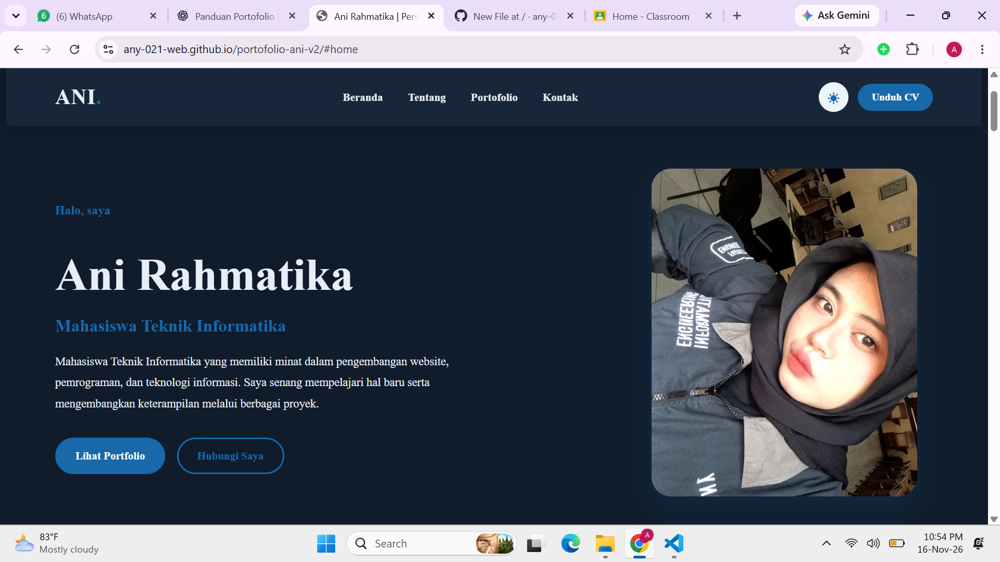
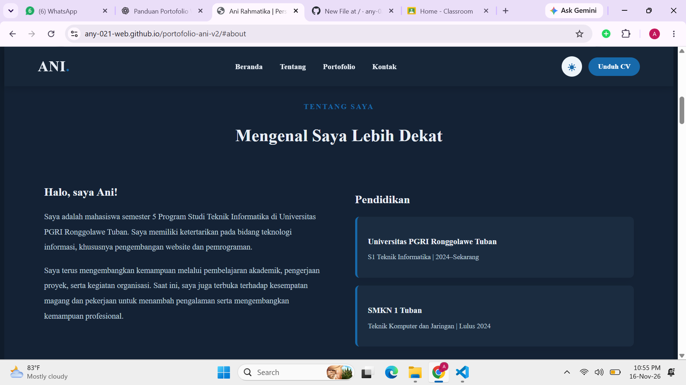
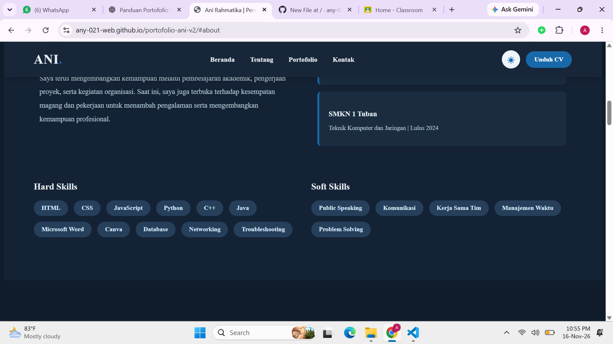
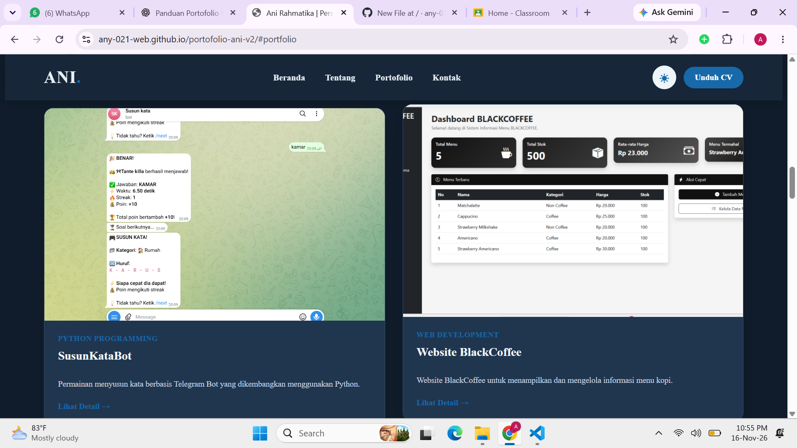
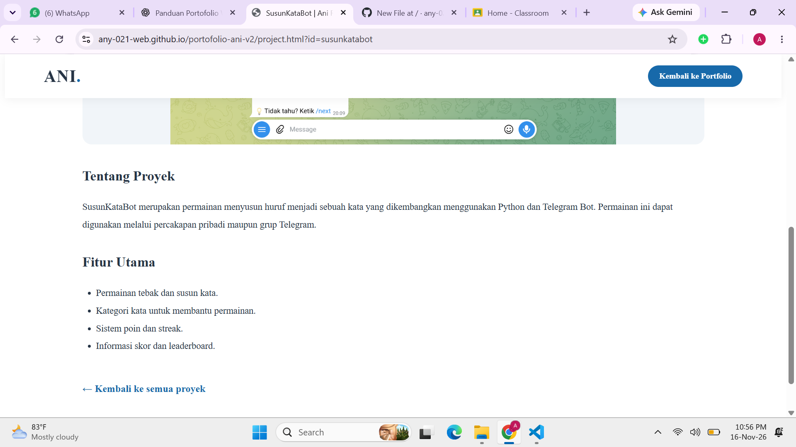
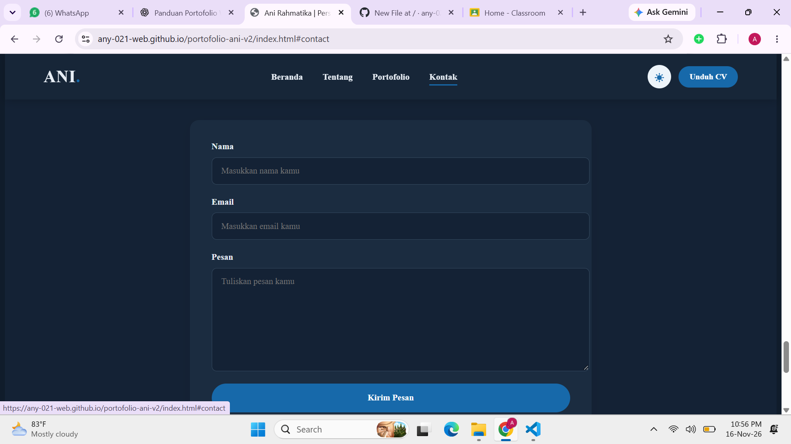
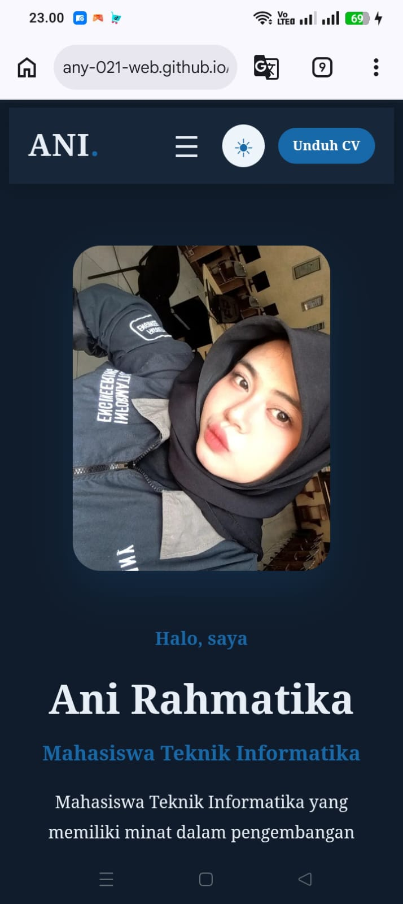

# Portfolio Website - Ani Rahmatika

## 1. Deskripsi Proyek

Portfolio Website Ani Rahmatika merupakan website pribadi yang dikembangkan sebagai media untuk memperkenalkan profil, latar belakang pendidikan, keterampilan, pengalaman organisasi, serta proyek yang telah dikerjakan.

Website ini dibuat menggunakan HTML, CSS, dan JavaScript dengan desain modern, minimalis, serta responsif agar dapat diakses melalui berbagai perangkat, baik desktop maupun mobile.

Website ini juga dilengkapi dengan fitur navigasi, dark mode, halaman detail proyek, dan formulir kontak.

## 2. Tujuan Pengembangan

Tujuan pengembangan website ini adalah:

- Memperkenalkan profil dan latar belakang pendidikan.
- Menampilkan keterampilan dan pengalaman yang dimiliki.
- Mendokumentasikan proyek akademik maupun proyek pribadi.
- Menyediakan media komunikasi melalui formulir kontak.
- Membangun personal branding dalam bidang teknologi informasi.

## 3. Fitur Website

- Homepage dan navigasi.
- About Me dan informasi pendidikan.
- Hard Skills dan Soft Skills.
- Portfolio berisi empat proyek.
- Halaman detail setiap proyek.
- Pengalaman organisasi dan kegiatan.
- Contact form.
- Dark mode dan light mode.
- Responsive design untuk desktop dan mobile.

## 4. Daftar Proyek

| No. | Nama Proyek | Kategori |
|---|---|---|
| 1 | SusunKataBot | Python Programming |
| 2 | Website BlackCoffee | Web Development |
| 3 | Website Style Cowo Ganteng | Web Development |
| 4 | Home Server Kami | System Operation |

## 5. Teknologi dan Tools

**Teknologi:**

- HTML5
- CSS3
- JavaScript
- EmailJS

**Tools:**

- Visual Studio Code
- Git
- GitHub
- GitHub Pages

## 6. Struktur Folder

```text
portofolio-ani-v2/
│
├── assets/
│   └── img/
│       ├── profile.jpg
│       ├── project1.png
│       ├── project2.png
│       ├── project3.png
│       └── project4.png
│
├── css/
│   ├── about.css
│   ├── contact.css
│   ├── detail.css
│   ├── footer.css
│   ├── hero.css
│   ├── navbar.css
│   ├── portfolio.css
│   ├── responsive.css
│   └── theme.css
│
├── js/
│   ├── contact.js
│   ├── detail.js
│   ├── main.js
│   ├── navbar.js
│   ├── projects.js
│   └── theme.js
│
├── screenshots/
│   ├── homepage.png
│   ├── about.png
│   ├── skills.png
│   ├── portfolio.png
│   ├── project-detail.png
│   ├── contact.png
│   └── mobile.png
│
├── cv.pdf
├── index.html
├── project.html
└── README.md
```

## 7. Cara Membuka dan Menjalankan

**Menjalankan secara lokal:**

1. Clone repository dari GitHub.
2. Buka folder proyek menggunakan Visual Studio Code.
3. Jalankan file `index.html` melalui browser atau menggunakan ekstensi Live Server.
4. Website dapat diakses dan diuji secara lokal.

**Mengakses website secara online:**

Website telah dipublikasikan menggunakan GitHub Pages dan dapat diakses melalui:

[https://any-021-web.github.io/portofolio-ani-v2/](https://any-021-web.github.io/portofolio-ani-v2/)

## 8. Design Decisions

Pengembangan desain website menggunakan beberapa pertimbangan berikut:

- **Color Palette:** Menggunakan kombinasi warna biru dan putih untuk menciptakan kesan profesional dan bersih.
- **Typography:** Menggunakan jenis huruf yang mudah dibaca agar informasi tersampaikan dengan jelas.
- **Layout:** Menggunakan susunan section dan grid agar konten lebih terstruktur.
- **Navigation:** Menyediakan navigasi untuk memudahkan pengunjung berpindah antarbagian website.
- **Responsive Design:** Menggunakan CSS media queries agar tampilan menyesuaikan ukuran layar perangkat.
- **Dark Mode:** Menyediakan pilihan tema terang dan gelap untuk kenyamanan pengguna.

## 9. Challenges & Solutions

Beberapa tantangan selama pengembangan website:

**1. Pengaturan Struktur Kode**

Tantangan: Mengelola kode HTML, CSS, dan JavaScript agar tidak tercampur dan sulit diperbarui.

Solusi: Memisahkan file berdasarkan fungsi dan tanggung jawab masing-masing.

**2. Responsive Design**

Tantangan: Menyesuaikan tampilan website agar tetap nyaman digunakan pada perangkat dengan ukuran layar berbeda.

Solusi: Menggunakan CSS Grid, Flexbox, dan media queries.

**3. Deployment Website**

Tantangan: Menghubungkan repository lokal dengan GitHub dan mempublikasikan website agar dapat diakses secara online.

Solusi: Menggunakan Git untuk version control dan GitHub Pages sebagai layanan hosting.

## 10. Screenshot / Documentation

Dokumentasi visual website digunakan untuk memperlihatkan hasil akhir pengembangan pada berbagai bagian website.

### 1. Homepage



### 2. About Me



### 3. Skills



### 4. Portfolio



### 5. Project Detail



### 6. Contact



### 7. Mobile View



## 11. Referensi

- HTML: [MDN Web Docs](https://developer.mozilla.org/en-US/docs/Web/HTML)
- CSS: [MDN Web Docs](https://developer.mozilla.org/en-US/docs/Web/CSS)
- JavaScript: [MDN Web Docs](https://developer.mozilla.org/en-US/docs/Web/JavaScript)
- GitHub Documentation: [GitHub Docs](https://docs.github.com/)
- GitHub Pages: [GitHub Pages](https://pages.github.com/)

---

**Developer:** Ani Rahmatika  
**Program Studi:** Teknik Informatika  
**Universitas:** Universitas PGRI Ronggolawe (UNIROW)  
**Project:** Personal Portfolio Website  
**Year:** 2026
